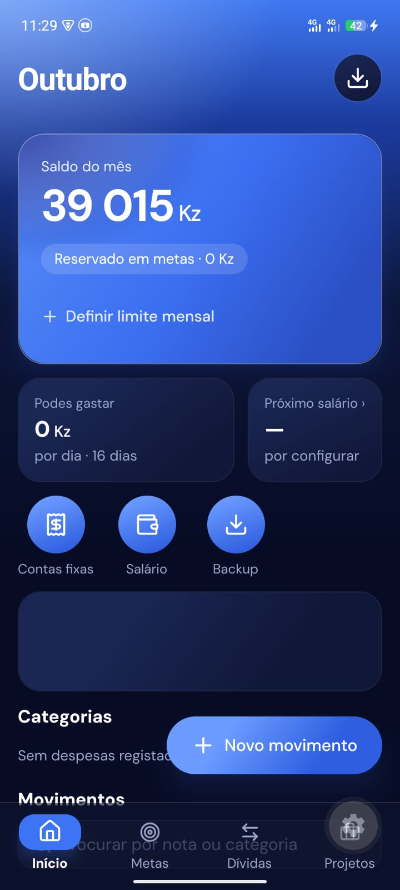
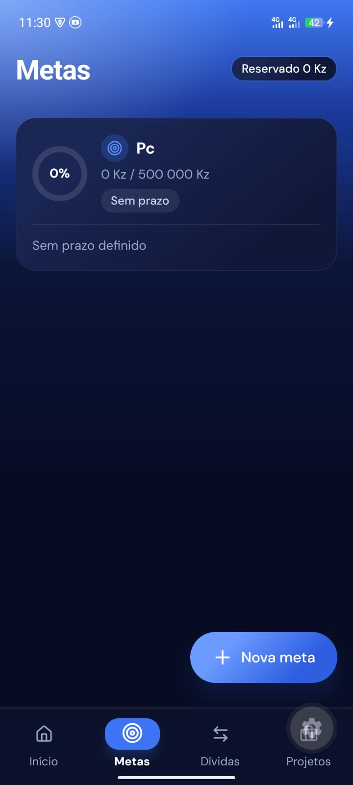
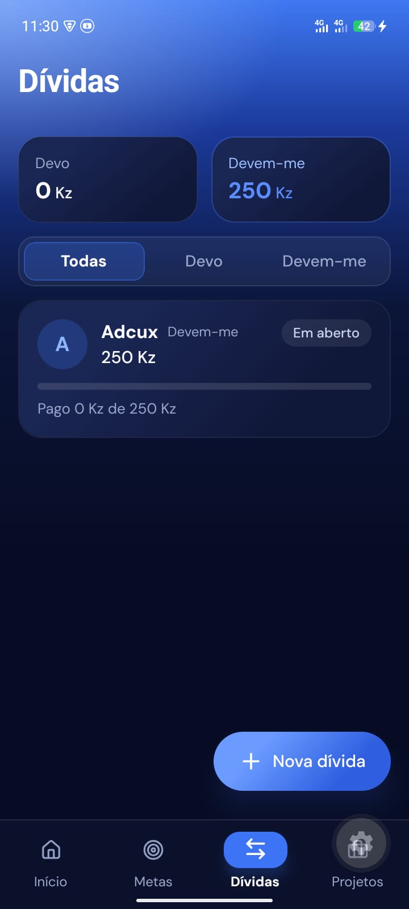
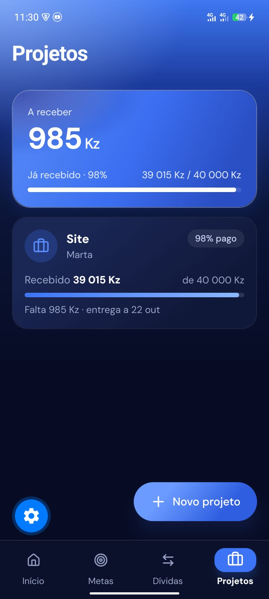

# App Financeiro

**Controla o teu dinheiro em Kwanzas, sem conta, sem internet e sem complicações.**

[**Descarregar para Android**](LINK_ANDROID_AQUI) &nbsp;|&nbsp; [**Descarregar para iOS**](LINK_IOS_AQUI)

---

## Porque usar o App Financeiro

A maioria das apps de finanças pede conta, envia os teus dados para a nuvem e não foi pensada para a nossa realidade. O App Financeiro foi feito para Angola: valores em **Kwanzas (Kz)**, português de Angola e tudo guardado **apenas no teu telemóvel**.

<table>
<tr>
<td width="50%" valign="top">

&nbsp;**Privado por defeito** 
Sem registo, sem servidor. Os teus dados nunca saem do telemóvel.

</td>
<td width="50%" valign="top">

&nbsp;**Funciona sem internet** 
Regista e consulta tudo em qualquer lugar, a qualquer hora.

</td>
</tr>
<tr>
<td valign="top">

&nbsp;**Registo em segundos** 
Teclado de valores próprio, categorias sugeridas e atalhos para o que mais usas.

</td>
<td valign="top">

&nbsp;**Pensado para uma mão** 
As ações principais ficam ao alcance do polegar.

</td>
</tr>
</table>

## O que podes fazer

| | Funcionalidade | Descrição |
| :-: | --- | --- |
|  | **Receitas e despesas** | Regista cada movimento com categoria, nota e data. Corrigiste mal? Toca em "Desfazer". |
|  | **Metas de poupança** | Define um objetivo e um prazo. A app diz quanto deves poupar por mês e se estás no ritmo. |
|  | **Dívidas** | Sabe quanto deves e quanto te devem, com pagamentos parciais e aviso de atrasos. |
|  | **Projetos e trabalhos** | Acompanha o que já recebeste de cada cliente e o que ainda falta receber. |
|  | **Salário** | Configura o dia do salário e a app lança-o como receita automaticamente. |
|  | **Contas fixas** | Renda, água, luz, internet: vê o que falta pagar no mês e recebe lembretes. |
|  | **Quanto posso gastar por dia** | Define um limite mensal e vê, todos os dias, o valor livre até ao próximo salário. |
|  | **Resumos e gráficos** | Percebe para onde vai o teu dinheiro, mês a mês. |
|  | **Cópia de segurança** | Exporta os teus dados (JSON ou CSV) e restaura quando trocares de telemóvel. |

## Capturas de ecrã

<!-- Substitui pelos teus ficheiros, por exemplo: assets/screenshots/inicio.png -->

| Início | Metas | Dívidas | Projetos |
| :-: | :-: | :-: | :-: |
|  |  |  |  |

## Como instalar

 **Android**
1. Descarrega o ficheiro de instalação através do botão no topo desta página.
2. Abre o ficheiro no telemóvel. Se for pedido, permite a instalação de fontes externas.
3. Abre o App Financeiro e começa a registar.

 **iOS**
1. Abre o link de descarga no topo desta página no teu iPhone.
2. Segue as instruções para instalar.

## Entrar em contacto
 
O App Financeiro é **totalmente grátis**. Queres pedir o link de instalação, tirar uma dúvida ou fazer uma sugestão? Fala diretamente comigo. Respondo o mais rápido possível.
 
| | Canal | Contacto |
| :-: | --- | --- |
|  | **WhatsApp** | [NÚMERO_AQUI](https://wa.me/NÚMERO_AQUI) |
|  | **Email** | [EMAIL_AQUI](mailto:EMAIL_AQUI) |
|  | **GitHub** | [Keybachira](https://github.com/Keybachira) |
|  | **Portfólio** | [aquiles-bachira.vercel.app](https://aquiles-bachira.vercel.app/) |

Ao contactar, diz-me qual é o teu telemóvel (Android ou iOS) para eu te enviar o link de instalação certo.

## Perguntas frequentes

**Os meus dados estão seguros?**
Ficam apenas no teu telemóvel. Não existe conta nem servidor. Faz cópias de segurança com regularidade, porque se perderes o telemóvel sem backup, os dados perdem-se também.

**Preciso de internet?**
Não. A app funciona totalmente offline.

**Posso mudar de telemóvel e levar os meus dados?**
Sim. Exporta uma cópia na secção de backup e importa-a no novo aparelho.

**Tem sincronização na nuvem?**
Não. É uma decisão de privacidade: os teus dados só existem onde tu os guardares.

**Encontrei um erro ou tenho uma sugestão.**
Abre um pedido na secção [Issues](https://github.com/Keybachira/app-financeiro/issues) ou fala comigo pelos contactos acima.

## Quer ajudar a melhorar a app?

O projeto aceita contribuições. Lê o guia em [CONTRIBUTING.md](CONTRIBUTING.md).

---

Feito em Angola por [Keybachira](https://github.com/Keybachira)

